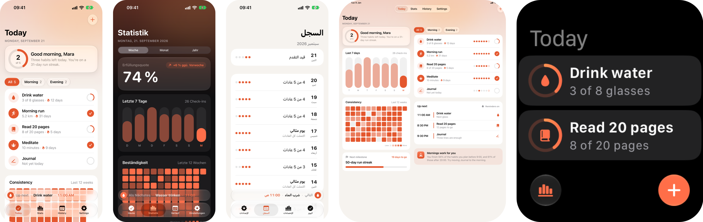
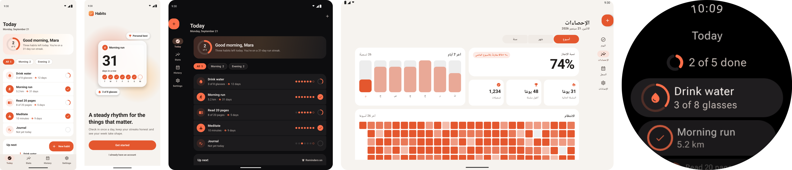
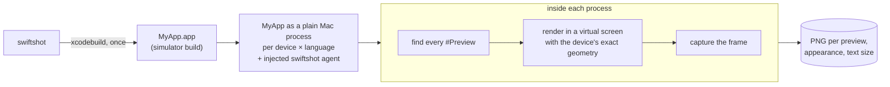
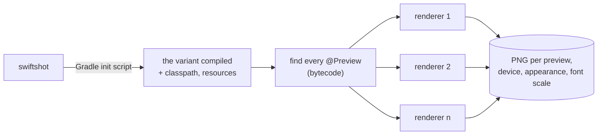

<p align="center">
  <picture>
    <source media="(prefers-color-scheme: dark)" srcset="docs/assets/logo-dark.svg">
    
  </picture>
</p>

<h1 align="center">Swiftshot</h1>

<p align="center">
  Fast screenshot tests from your SwiftUI, UIKit, Jetpack Compose, Compose Multiplatform and Flutter previews, without a simulator or emulator. Also makes App Store and Google Play screenshots.
</p>

<p align="center">
  <a href="https://github.com/LukasAnda/swiftshot/actions/workflows/tests.yml"></a>
  <a href="https://github.com/LukasAnda/swiftshot/releases/latest"></a>
  <a href="https://github.com/marketplace/actions/swiftshot-preview-screenshots"></a>
  
  
  <a href="LICENSE"></a>
</p>

<p align="center">
  <a href="#install">Install</a> ·
  <a href="#quick-start">Quick start</a> ·
  <a href="#ci">CI</a> ·
  <a href="#device-frames">Device frames</a> ·
  <a href="#speed">Speed</a> ·
  <a href="#how-it-works">How it works</a> ·
  <a href="https://github.com/LukasAnda/swiftshot/wiki">Documentation</a>
</p>

<p align="center">
  
</p>
<p align="center">
  
</p>

One command renders every preview for every device, language and appearance, straight into the
folders `fastlane deliver` and `fastlane supply` upload from.

**iOS**: SwiftUI and UIKit `#Preview`s

- No UI tests, no `SnapshotHelper.swift`, no simulator to boot.
- iPhone, iPad, iPhone Duo and Apple Watch; every iOS version, language, appearance and text size.
- Pixel identical to a booted simulator's framebuffer, status bar included.

**Android**: Jetpack Compose `@Preview`s

- No instrumentation tests, no emulator, no test source set. Runs on a Mac or on Linux.
- Phones, foldables (folded and unfolded), tablets and Wear OS from Android Studio's catalog.
- Edge-to-edge insets with each Pixel's real status bar, dialogs and sheets, `@PreviewParameter`.

Both get device frames, full-length scrolling screens, per-screenshot settings, an HTML gallery and
a JSON report.

**Compose Multiplatform**: shared `@Preview`s

- Android, desktop and iOS screenshots from one module, in one run.
- iOS through the same no-boot renderer, pixel identical to a booted simulator (Mac with Xcode).
- On Linux, the Android and desktop targets; iOS is skipped.

**Flutter**: widget `@Preview`s

- iPhone, iPad and Android devices from one run, on a Mac or on Linux.
- On a Mac with Xcode, iPhones and iPads render on Flutter's iOS engine, pixel identical to a
  booted simulator.

## Install

On a Mac (Apple silicon), for iOS and Android:

```
brew install lukasanda/tap/swiftshot
```

On Linux, for Android, desktop, Compose Multiplatform and Flutter (no iOS), with a JDK 21+:

| | |
|---|---|
| Homebrew | `brew install lukasanda/tap/swiftshot` |
| Debian, Ubuntu | `curl -fsSLO https://github.com/LukasAnda/swiftshot/releases/latest/download/swiftshot_all.deb && sudo apt install ./swiftshot_all.deb` |
| Fedora, RHEL, openSUSE | `sudo dnf install https://github.com/LukasAnda/swiftshot/releases/latest/download/swiftshot.noarch.rpm` |

Or without a package manager, on a Mac or on Linux:

```
curl -fsSL https://raw.githubusercontent.com/LukasAnda/swiftshot/main/install.sh | sh
export PATH="$HOME/.swiftshot/bin:$PATH"
```

The script installs the latest release into `~/.swiftshot/bin` (set `SWIFTSHOT_PREFIX` to change
it) and checks its SHA-256. To build from source: `git clone https://github.com/LukasAnda/swiftshot
&& cd swiftshot && make install`.

## Quick start

Run `swiftshot init` in your project, then `swiftshot`. `init` writes a `swiftshot.json` with what
it detects; `swiftshot` picks the platform from the project in the folder.

### iOS

In the folder with your Xcode project or workspace. `init` detects the scheme (and a watchOS
scheme), the languages from the project's known regions and App Store devices installed on this
Mac. Or pass everything on the command line:

```
swiftshot --project MyApp.xcodeproj --scheme MyApp \
  --devices "iPhone 17 Pro Max,iPad Pro 13-inch (M5)" \
  --languages "en-US,de-DE" --appearances light,dark
```

Build with the Debug configuration (the default): the compiler only includes `#Preview` code in
Debug builds.

### Android

In the folder with `gradlew`. `init` detects the Android modules (and a Wear OS module), the
languages from the `values-*` resource folders and Play Store devices:

```
swiftshot --devices "Pixel 10 Pro,Pixel 9 Pro Fold,Pixel Tablet" \
  --languages "en-US,de-DE" --appearances light,dark
```

Needs a JDK 21+ (Android Studio's is found automatically) and `ui-tooling` on the debug classpath,
as Android Studio's previews do:

```kotlin
debugImplementation("androidx.compose.ui:ui-tooling")
```

Nothing else is added to the project.

### Compose Multiplatform

Also in the folder with `gradlew`. Every target the module has is rendered: Android, desktop
(`jvm()`) and iOS (`iosSimulatorArm64()`, on a Mac with Xcode):

```
swiftshot --devices "Pixel 10 Pro" --desktop-devices "Desktop 1440×900 @2x" \
  --ios-devices "iPhone 17 Pro Max,iPad Pro 13-inch (M5)" --platforms android,desktop,ios
```

See the [Compose Multiplatform](https://github.com/LukasAnda/swiftshot/wiki/Compose-Multiplatform)
wiki page.

### Flutter

In the folder with `pubspec.yaml`. `init` takes the languages from the gen-l10n ARB files:

```
swiftshot --devices "iPhone 17 Pro Max,Pixel 10 Pro" --languages "en-US,de" --appearances light,dark
```

Needs Flutter 3.35+ (widget previews) and a JDK 21+. See the
[Flutter](https://github.com/LukasAnda/swiftshot/wiki/Flutter) wiki page.

### Output

- `screenshots/<language>/<device>-<preview>.png`
- `screenshots/screenshots.html`, a gallery to review them
- `screenshots/swiftshot-report.json`, a machine-readable report

`swiftshot list` prints the previews it found, `swiftshot devices` the devices.

## CI

iOS needs a Mac with Xcode and the runtimes you render; it runs on the free `macos-26` and
`xcode-27` runners. Android, desktop, Compose Multiplatform (without iOS) and Flutter run on any
runner with a JDK 21+, including `ubuntu-latest`. Neither boots a simulator or an emulator.

```yaml
jobs:
  ios:
    runs-on: xcode-27
    steps:
      - uses: actions/checkout@v7
      - uses: LukasAnda/swiftshot@v0.7.0
        with:
          version: 0.7.0      # or "latest"
      - uses: actions/upload-artifact@v7
        with: { name: ios-screenshots, path: fastlane/screenshots }

  android:
    runs-on: ubuntu-latest
    steps:
      - uses: actions/checkout@v7
      - uses: actions/setup-java@v6
        with: { distribution: temurin, java-version: 21 }
      - uses: LukasAnda/swiftshot@v0.7.0
        with:
          version: 0.7.0
      - uses: actions/upload-artifact@v7
        with: { name: android-screenshots, path: fastlane/metadata/android }
```

The action installs the release and runs `swiftshot run` with your `swiftshot.json`, or with
`args`. Use `working-directory` if the project isn't at the repo root.

Other CI:

```
curl -fsSL https://raw.githubusercontent.com/LukasAnda/swiftshot/main/install.sh | SWIFTSHOT_VERSION=0.7.0 sh
~/.swiftshot/bin/swiftshot run
```

The exit code is non-zero if any screenshot failed.

### fastlane

```
fastlane add_plugin swiftshot
```

```ruby
lane :screenshots do
  swiftshot(devices: ["iPhone 17 Pro Max"], languages: ["en-US", "de-DE"])  # was capture_ios_screenshots
  upload_to_app_store
end
```

See [fastlane-plugin-swiftshot](https://github.com/LukasAnda/fastlane-plugin-swiftshot) for the
options.

### Visual review tools

The output is plain PNGs with stable names, so screenshot review services take it as is:

```
npx @argos-ci/cli upload fastlane/screenshots   # Argos, needs ARGOS_TOKEN
npx @percy/cli upload fastlane/screenshots      # Percy, needs PERCY_TOKEN
```

## Configuration

`swiftshot.json` sits next to your project. Every key is also a flag (`swiftshot --help`). Keys
mean the same on both platforms where they can.

iOS (keys follow fastlane's `Snapfile`):

```json
{
  "project": "MyApp.xcodeproj",
  "scheme": "MyApp",
  "devices": ["iPhone 17 Pro Max", "iPad Pro 13-inch (M5)"],
  "ios_versions": ["27.0"],
  "languages": ["en-US", "de-DE", "ja"],
  "appearances": ["light", "dark"],
  "output_directory": "fastlane/screenshots",
  "clear_previous_screenshots": true
}
```

Android:

```json
{
  "modules": [":app", ":wear"],
  "devices": ["Pixel 10 Pro", "Pixel 9 Pro Fold", "Pixel 9 Pro Fold (folded)", "Pixel Tablet"],
  "watch_devices": ["Wear OS Large Round"],
  "languages": ["en-US", "de-DE", "ja"],
  "appearances": ["light", "dark"],
  "font_scales": [1, 1.3],
  "output_directory": "fastlane/metadata/android",
  "layout": "fastlane",
  "clear_previous_screenshots": true
}
```

`"layout": "fastlane"` writes `<locale>/images/phoneScreenshots`, `sevenInchScreenshots`,
`tenInchScreenshots`, `wearScreenshots` and `desktopScreenshots`, the folders `fastlane supply`
uploads from.

Compose Multiplatform adds `platforms`, `desktop_devices`, `ios_devices` and `ios_versions`.
Flutter adds `flutter_root` (the SDK) and `flutter_ios` (`exact` or `headless`).

### Per-screenshot settings

Override settings for previews that match a name or `*` glob. The first match wins.

```
swiftshot --screen "Welcome: appearances=light,dark" \
          --screen "Stats: languages=de-DE,ja devices=Pixel*" \
          --screen "Debug*: skip=true"
```

Or in `swiftshot.json`:

```json
"screens": [
  { "preview": "Welcome", "appearances": ["light", "dark"] },
  { "preview": "History", "full_length": true },
  { "preview": "Debug*", "skip": true }
]
```

Keys: `appearances`, `languages`, `devices`, `full_length`, `delay`, `skip`; on iOS also
`ios_versions` and `text_sizes`, on Android `font_scales`.

### Previews

On iOS:

- Bodies can be SwiftUI views, `UIViewController`s or `UIView`s.
- `.sizeThatFitsLayout` and `.fixedLayout(width:height:)` render at their own size, like in Xcode.
- Sheets and alerts presented in the preview are captured fully presented.
- `--text-sizes default,XXXL,AX5` renders Dynamic Type sizes; the status bar shows 9:41.

On Android, each `@Preview` renders as in Android Studio:

- `showSystemUi = true` renders the whole screen with the status bar and gesture handle; without
  it, the composable at its own size.
- The preview's own `device`, `widthDp`/`heightDp`, `locale`, dark `uiMode` and `fontScale` win
  over the matrix.
- Multipreviews (`@PreviewLightDark`, `@PreviewScreenSizes`, `@PreviewFontScale`,
  `@WearPreviewDevices`, your own) expand like in the IDE; `@PreviewParameter` gives one
  screenshot per value.
- Dialogs, bottom sheets and popups shown in the preview are captured.
- Wear OS modules render on watch devices, dark; round screens get black corners, as Play wants.

On both, `--full-length` grows scrolling screens to their whole content and `--delay <seconds>`
waits (iOS) or advances the clock (Android) before each capture.

## Device frames

```
swiftshot --frame plain           # the device with the screenshot in it
swiftshot --frame appstore        # iOS: App Store size, background and localized title
swiftshot frame fastlane/screenshots --frame appstore   # iOS: an existing folder, like frameit
```

- **iOS** uses Apple's official bezels, downloaded from Apple on first use under its Design
  Resources License (`--accept-bezel-license` on CI). App Store frames are written next to the
  originals as `<name>_framed.png`, at a size App Store Connect accepts, with titles from
  `title.strings` or a frameit `Framefile.json`.
- **Android** uses Android Studio's device art (Apache 2.0) for every Pixel, foldables folded and
  unfolded, the Pixel Tablet and Wear OS watches, from Android Studio, the SDK or AOSP.
- Plain frames go to `screenshots-framed/<language>/<name>_framed.png`.

The [Device frames](https://github.com/LukasAnda/swiftshot/wiki/Device-frames) wiki page has the
full reference.

## Speed

Both benchmarks run on free GitHub-hosted runners, as workflows in this repo
([iOS](.github/workflows/benchmark.yml), [Android](.github/workflows/android-benchmark.yml)), so
anyone can re-run them. The numbers below link to the runs they come from.

**iOS: swiftshot vs `fastlane snapshot`.** 5 screens of `Example/DemoApp` on 3 devices in 3
languages, 45 screenshots each, on the `xcode-27` runner from a cold start
([run](https://github.com/LukasAnda/swiftshot/actions/runs/40598242160)):

| | wall clock | per screenshot |
|---|---:|---:|
| `fastlane snapshot` | 4195 s (70 min) | 93 s |
| swiftshot, cold | **99 s** | 2.2 s |
| swiftshot, warm build | **56 s** | 1.2 s |

**Android: swiftshot vs Paparazzi and Roborazzi.** The `Example/AndroidDemo` previews on a Pixel
10 Pro and a Pixel Tablet, five languages, light and dark, 470 screenshots each, on a 4-core
`ubuntu-latest` runner ([`bench/android`](bench/android),
[run](https://github.com/LukasAnda/swiftshot/actions/runs/40493772786)):

| | swiftshot | Paparazzi | Roborazzi |
|---|---:|---:|---:|
| first run | **59.4 s** | 86.8 s | 87.7 s |
| warm run | **36.7 s** | 63.6 s | 70.2 s |

fastlane boots a simulator per device and runs a UI-test session per device and language.
Paparazzi and Roborazzi render screenshots as unit tests, one at a time per test JVM. Swiftshot
renders the previews directly, in parallel processes that stay up for the whole run.

**Compose Multiplatform.** `Example/MultiplatformDemo`, 9 previews in two languages on an
Apple silicon Mac: 90 screenshots (Android phone and tablet, desktop, iPhone and iPad) in 19 s.

**Flutter.** `Example/FlutterDemo`, 12 previews in five languages, light and dark: 204
screenshots (iPhone and Pixel) in about 11 s headless on an Apple silicon Mac, 45 s on a 4-core
Linux runner.

## How it works

**iOS**



1. Swiftshot builds the app once for the iOS simulator.
2. It runs the app directly on the Mac against the simulator runtime, with a small injected
   library. No simulator is booted; a helper provides the Metal, IOSurface and shader compiler
   services a booted simulator would.
3. The library finds every `#Preview` and answers UIKit's questions about the screen with the
   target device's measured geometry: size, scale, corner radii, safe areas, Dynamic Island.
4. The app's windows go to a Core Animation render server in the same process, on a virtual
   display. Its frame is the screenshot. The status bar is the system's own.

`--mode device` renders in booted simulators instead and is the reference: CI checks the output is
pixel identical.

**Android**



1. Swiftshot runs one Gradle task through an init script: the variant compiles as usual and the
   task describes its classes, classpath and resources. Nothing in the project changes.
2. It reads `@Preview`s from the compiled classes, multipreviews included.
3. Renderer processes load the app's classpath with layoutlib, the engine of Android Studio's
   previews, through Paparazzi's SDK. They start while Gradle builds, then each renders whole
   groups of screenshots (one device, language, appearance and font scale) in parallel.
4. Content gets the device's real insets; the status bar and gesture handle are drawn over the
   frame, as system windows are on a device.

**Compose Multiplatform**

The Android target renders as above, the desktop target with Compose's own headless
`ImageComposeScene`. For iOS, Swiftshot links a framework with a wrapper per preview, builds a
small SwiftUI host app with a `#Preview` for each, and renders it like any iOS app.

**Flutter**

Previews are found in `lib/` without building. `flutter test` renders them headless, one process
per language. On a Mac with Xcode, iPhones and iPads render instead on Flutter's iOS engine: the
app's Flutter bundle in a small SwiftUI host app, through the same no-boot iOS renderer.

The [How it works](https://github.com/LukasAnda/swiftshot/wiki/How-it-works) wiki page has the full
explanation and diagrams.

## Requirements

iOS:

- Apple silicon Mac
- Xcode 26.6 or 27.x with the simulator runtimes you want to render (Xcode > Settings > Components)
- An app target with `#Preview`s (iOS 17+)

Android:

- macOS or Linux with a JDK 21+
- A Gradle project with Compose `@Preview`s and `ui-tooling` on the debug classpath

Compose Multiplatform:

- As Android, plus a Mac with Xcode for the iOS target. Linux renders the Android and desktop
  targets.

Flutter:

- macOS or Linux with a JDK 21+ and Flutter 3.35+, `flutter_test` among the dev dependencies
- For exact iPhone and iPad screenshots: a Mac with Xcode and the project's `ios/` folder

## Development

```
make                                                   # bin/: the CLI, iOS agents, Android jars
swift test --filter swiftshotTests                     # iOS unit tests
SWIFTSHOT_INTEGRATION=1 swift test --filter IntegrationTests
(cd Android && ./gradlew :cli:test)                    # Android unit tests
Android/ci/integration.sh                              # Android integration
```

The iOS integration tests compare `Example/DemoApp` pixel by pixel with booted simulators; the
Android ones render `Example/AndroidDemo` on every device type and check sizes, determinism and
the time budget.

## Roadmap

| version | |
|---|---|
| [v0.3.0](https://github.com/LukasAnda/swiftshot/releases/tag/v0.3.0) | Homebrew: `brew install lukasanda/tap/swiftshot` (released) |
| [v0.4.0](https://github.com/LukasAnda/swiftshot/releases/tag/v0.4.0) | Android: Jetpack Compose previews (released) |
| [v0.5.0](https://github.com/LukasAnda/swiftshot/releases/tag/v0.5.0) | Compose Multiplatform: Android, desktop and iOS (released) |
| [v0.6.0](https://github.com/LukasAnda/swiftshot/releases/tag/v0.6.0) | Linux as a full host: the same `swiftshot` command, setup and config as on a Mac (released) |
| [v0.7.0](https://github.com/LukasAnda/swiftshot/milestone/4) | Flutter: widget previews on iOS and Android devices (released) |
| [v0.8.0](https://github.com/LukasAnda/swiftshot/milestone/7) | Easy migration from Paparazzi and Roborazzi: `swiftshot init` sets Swiftshot up to match |
| [v0.9.0](https://github.com/LukasAnda/swiftshot/milestone/5) | IDE plugins for Xcode, Android Studio and IntelliJ IDEA |

Version numbers are targets and can move. Details on the
[Roadmap](https://github.com/LukasAnda/swiftshot/wiki/Roadmap) wiki page; suggestions are welcome as
[feature requests](https://github.com/LukasAnda/swiftshot/issues/new?template=feature_request.yml).

## Documentation

The [wiki](https://github.com/LukasAnda/swiftshot/wiki) has the full configuration reference for
every platform, the [Android](https://github.com/LukasAnda/swiftshot/wiki/Android) and
[Compose Multiplatform](https://github.com/LukasAnda/swiftshot/wiki/Compose-Multiplatform) and
[Flutter](https://github.com/LukasAnda/swiftshot/wiki/Flutter) guides, CI
recipes, migration guides from fastlane and troubleshooting.

## Contributing

Bug reports and pull requests are welcome. See [CONTRIBUTING.md](CONTRIBUTING.md).

## License

AGPL-3.0 — see [LICENSE](LICENSE).

Using swiftshot doesn't put your app or your screenshots under the AGPL: running the tool, in CI
or anywhere else, leaves your code and its output yours. The AGPL applies to swiftshot itself,
if you change it and distribute it or offer it as a service.
