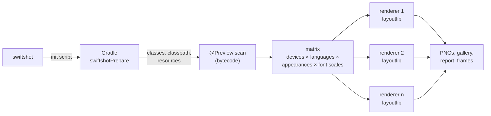

Swiftshot renders Google Play screenshots from your Jetpack Compose `@Preview`s for phones,
foldables, tablets and Wear OS, in every language and appearance, without an emulator. It runs on
a Mac or on Linux (CI).

For Compose Multiplatform modules (Android, desktop and iOS) see [[Compose Multiplatform]].

## Requirements

- JDK 21 or later (Android Studio's bundled one is found automatically)
- An Android app or library module with Compose `@Preview`s
- `androidx.compose.ui:ui-tooling` on the debug classpath, as Android Studio's previews need too:

```kotlin
debugImplementation("androidx.compose.ui:ui-tooling")
```

- `mavenCentral()` among the project's repositories: Swiftshot's task resolves Paparazzi's
  layoutlib SDK from there

Nothing else is added to the project: Swiftshot adds its Gradle task for its own run only.

## Install

On an Apple silicon Mac, the regular install includes Android support. On Linux: Homebrew, a
`.deb`, an `.rpm` or the install script, see [[Installation]]. On an Intel Mac:

```
curl -fsSL https://raw.githubusercontent.com/LukasAnda/swiftshot/main/install.sh | sh
export PATH="$HOME/.swiftshot/bin:$PATH"
```

## Quick start

In the folder with `gradlew`:

```
swiftshot init      # writes swiftshot.json: modules, languages, Play devices
swiftshot           # renders everything
open screenshots/screenshots.html
```

`swiftshot list` prints the previews it found, `swiftshot devices` the devices.

## Configuration

`swiftshot.json` uses the same keys as on iOS where they mean the same thing. It is a file of its
own: keys only iOS knows, such as `scheme`, are rejected.

```json
{
  "modules": [":app", ":wear"],
  "devices": ["Pixel 10 Pro", "Pixel 9 Pro Fold", "Pixel 9 Pro Fold (folded)", "Pixel Tablet"],
  "watch_devices": ["Wear OS Large Round"],
  "languages": ["en-US", "de-DE", "ja", "ar"],
  "appearances": ["light", "dark"],
  "font_scales": [1, 1.3],
  "output_directory": "fastlane/metadata/android",
  "layout": "fastlane",
  "screens": [
    { "preview": "Stats", "full_length": true },
    { "preview": "Debug*", "skip": true }
  ]
}
```

| key | default | |
|---|---|---|
| `project_dir` | `.` | the Gradle project |
| `modules` | every Android module | e.g. `[":app", ":wear"]` |
| `variant` | `debug` | build variant |
| `gradle_args` | `[]` | extra Gradle arguments |
| `devices` | Pixel 10 Pro, Pixel Tablet | phones, foldables, tablets (`swiftshot devices`) |
| `watch_devices` | Wear OS Large Round | for Wear OS modules |
| `languages` | `["en-US"]` | BCP 47 tags |
| `appearances` | `["light"]` | `light`, `dark` |
| `font_scales` | `[1]` | e.g. `[1, 1.3, 2]` |
| `previews` | all | names or `*` globs |
| `output_directory` | `screenshots` | |
| `layout` | `swiftshot` | `fastlane`: `<locale>/images/phoneScreenshots/…` for `fastlane supply` |
| `clear_previous_screenshots` | `false` | |
| `html` | `true` | write `screenshots.html` |
| `full_length` | `false` | grow scrolling screens to their whole content |
| `delay` | `0` | seconds to advance the clock before capture |
| `system_ui` | `preview` | status and navigation bars: as `showSystemUi` says, `always`, `never` |
| `frame` | `none` | `plain`: the device around the screenshot, see [[Device frames]] |
| `round_corners` | `black` | outside round watch screens: `black`, `transparent`; Play rejects transparency |
| `android_theme` | the app's theme | window theme for every preview; default: the `<application>` theme in the module's manifest, else Material's |
| `parallel` | from cores and memory | renderer processes: one per core and 1.5 GB, at most 8 |
| `java_home` | | JDK 21+ for Gradle and the renderer |
| `screens` | `[]` | per-screenshot settings, below |

`screens` rules match previews by name or `*` glob; the first match wins. Keys: `preview`,
`appearances`, `languages`, `devices`, `font_scales`, `full_length`, `delay`, `skip`. On the
command line: `--screen "Stats: languages=de-DE,ja devices=Pixel*"`.

## Previews

Each `@Preview` renders as in Android Studio:

- `showSystemUi = true`: the whole screen with the status bar and gesture handle. Apps that
  target API 35 or later are edge-to-edge, as Android enforces: the content gets the system bar
  insets and draws behind them.
- Without it: the composable at its own size (a component).
- `device`, `widthDp`/`heightDp`, `locale`, `uiMode` (dark), `fontScale`: the preview's own value
  wins over the matrix, so `@Preview(device = Devices.PIXEL_TABLET)` renders only on that tablet.
- Multipreviews (`@PreviewLightDark`, `@PreviewScreenSizes`, `@PreviewFontScale`,
  `@WearPreviewDevices`, your own) expand like in the IDE, named `Function - Name`.
- `@PreviewParameter`: one screenshot per value, `Name_1.png`, `Name_2.png`…
- Dialogs, bottom sheets and popups shown in the preview are captured, as real windows.

## Devices

The device list is Android Studio's own catalog, generated into Swiftshot: every Pixel, the
reference phones and tablets, foldables unfolded and folded (`Pixel 9 Pro Fold (folded)` is the
outer screen) and Wear OS round and square screens. Wear OS modules (those using Wear Compose)
render on `watch_devices`, once, dark (Wear OS has no light mode).

## Output

```
<output_directory>/<language>/<device>-<preview>[-<appearance>][-<font scale>x].png
<output_directory>/screenshots.html
<output_directory>/swiftshot-report.json
```

- `-light` / `-dark` when both are rendered, `-dark` also when only dark is. None when the preview
  sets `uiMode` itself, and none on Wear OS.
- `-1.3x` for a font scale other than 1, or when several are rendered.
- `@PreviewParameter` values: `_1`, `_2`… Two previews with the same name: the second gets ` 2`.

With `"layout": "fastlane"`, screenshots go where `fastlane supply` uploads them from, inside
`output_directory` (use `fastlane/metadata/android`):

| device | folder |
|---|---|
| phones | `<locale>/images/phoneScreenshots` |
| tablets and foldables up to 9" | `<locale>/images/sevenInchScreenshots` |
| larger tablets and foldables | `<locale>/images/tenInchScreenshots` |
| Wear OS | `<locale>/images/wearScreenshots` |
| TV | `<locale>/images/tvScreenshots` |

`--frame plain` writes framed copies to `<output_directory>-framed/`, see [[Device frames]].

## CI

Linux runners are enough:

```yaml
jobs:
  screenshots:
    runs-on: ubuntu-latest
    steps:
      - uses: actions/checkout@v7
      - uses: actions/setup-java@v6
        with: { distribution: temurin, java-version: 21 }
      - uses: LukasAnda/swiftshot@v0.7.0
      - uses: actions/upload-artifact@v7
        with: { name: screenshots, path: screenshots }
```

More in [[CI]].

## How it works



Renderer processes start while Gradle is still building, from the previous run's classpath, and
are kept when it is unchanged.

1. **Build.** Swiftshot runs `./gradlew swiftshotPrepare` with an init script: the variant is
   compiled as usual and the task writes the module's classes, runtime classpath, resources and
   assets to a JSON file. Nothing in the project changes.
2. **Find previews.** `@Preview` is invisible to reflection (binary retention), so Swiftshot reads
   the compiled class files directly, resolving multipreview annotations from the project and its
   libraries.
3. **Render.** Renderer processes load the app's classpath together with layoutlib, the rendering
   engine of Android Studio's previews, through Paparazzi's SDK. Each process starts once and then
   renders whole groups of screenshots (one device, language, appearance and font scale) by
   swapping only the composable. Several processes run in parallel; a class-data-sharing archive
   makes each one start faster after the first run.
4. **System UI.** On a device the status bar and gesture handle are system windows above the app,
   so Swiftshot hands the content real insets and draws the bars over the finished frame.

Paparazzi and Roborazzi run screenshots as unit tests: Gradle compiles a test source set and a
test task renders one screenshot per test, one at a time per JVM. Swiftshot skips the test
machinery and renders in parallel processes that stay up for the whole run.

More in [[How it works]].

## Speed

The same 470 screenshots from each tool (the demo app's `:app` previews on a Pixel 10 Pro and a
Pixel Tablet, en-US, de-DE, sk, ar, ja, light and dark), on a free 4-core `ubuntu-latest` runner,
one tool after another, the same number of processes for each
([`bench/android`](https://github.com/LukasAnda/swiftshot/tree/main/bench/android)):

| | swiftshot | Paparazzi 2.0.0-alpha05.1 | Roborazzi 1.77.0 |
|---|---:|---:|---:|
| first run (compiles, renders) | **59.4 s** | 86.8 s | 87.7 s |
| warm run | **36.7 s** | 63.6 s | 70.2 s |

What makes the difference:

- No test source set to compile and no test task: one Gradle task writes a JSON file.
- Renderers start while Gradle builds and render whole groups of screenshots each.
- PNG encoding runs beside the next render, at a fast compression level.
- The project's configuration cache is kept: a warm Gradle step takes about a second.

## Limitations

- `apiLevel` in `@Preview` is ignored: every preview renders with layoutlib's Android version.
- Foldables render flat (no hinge posture), as in Android Studio.
- Android TV and Automotive devices render, but get no system bars.
- `swiftshot frame <dir>` and App Store-style frames are iOS only.
